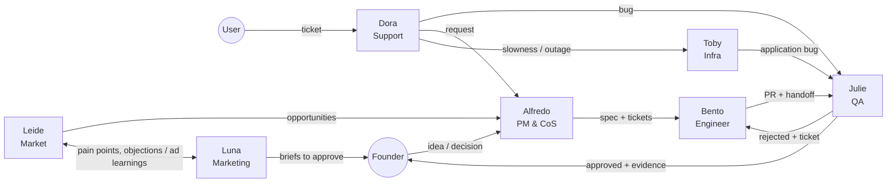

# my-bots — SaaS Ops on OpenMausBot

The source of truth for the bot team that runs our SaaS products on
[OpenMausBot](https://github.com/milind-soni/OpenMausBot). It holds each bot's
instructions, playbooks, team skills, rooms, and routines. A script builds the
package OpenMausBot imports under **Teams → Import**. Engineering, product, and
design skills come from the studio's skills repository, imported into every
product (see the [contract](#contract-with-the-skills-repository) below).

| Bot | Role | Owns |
| --- | --- | --- |
| **Alfredo** (`pm`) | PM & Chief of Staff | Specs, tickets, priorities, coordination, rituals |
| **Bento** (`engineer`) | Software Engineer | Features, bugs, data modeling, APIs |
| **Julie** (`qa`) | QA | Review, testing, screenshots and recordings, adversarial tests, bug tickets |
| **Toby** (`infra`) | Infrastructure | Servers, deploys, logs, performance, cost, incidents |
| **Dora** (`support`) | Support | User tickets, support knowledge base, escalating bugs to Julie |
| **Leide** (`market`) | Market Analyst | Competitor reverse engineering, trends, user pain points |
| **Luna** (`marketing`) | Marketing Analyst | Competitors' ad strategy, trending organic content, creatives |

## How OpenMausBot works (the essentials)

- **A chat app where bots are contacts.** Each bot is a real agent running on
  the CLIs you already have installed (`claude`, `codex`, or `grok`), on your
  own subscription. Each bot has its own model, memory, computer, and
  connected apps.
- **Local-first.** A harness server on `127.0.0.1:8799` manages the agents.
  Conversations, keys, and memory live in `~/.openmausbot`.
- **Standing instructions (soul)** define who a bot is. **Playbooks** are
  instructions injected when a conversation matches their triggers.
  **Skills** are `SKILL.md` files the bot reads on demand.
- **Memory:** each bot has a `MEMORY.md` (the first 200 lines load every
  turn) plus topic notes.
- **Channels and rooms:** a channel has its own transcript, shared
  instructions, working folder, and members. Bots hand work to each other
  with `coordinate_bots`. The team's **Chief of Staff** coordinates, and when
  it delegates, its approval level flows down to the delegated work.
- **Approvals:** commands, edits, and risky actions show up as Allow/Deny
  cards. Each bot has a level (Ask, Auto-accept edits, Approve for me, Full
  access).
- **Computers:** a cloud Linux desktop (Boat), an isolated local VM, or your
  own machine (on Ubuntu, only on Xorg with explicit opt-in).
- **Connected apps:** GitHub, Linear, Slack, Notion, and 500+ more via
  Composio, over OAuth.
- **Routines:** schedules (cron with a time zone) and webhooks. They run only
  while the app is open, or with `openmausbot serve` on a server.

## Two layers of skills

| Layer | Where it lives | What it is |
| --- | --- | --- |
| **Team skills** | `skills/` in this repo, shipped inside the OpenMausBot package | Short templates tied to the roles: QA handoff, bug ticket, visual evidence, support escalation, incident report, market sources |
| **Project skills** | Your skills repo, imported into `.claude/skills/` of every product | [mattpocock/skills](https://github.com/mattpocock/skills), [revenue-centric-design](https://github.com/heliocosta-dev/revenue-centric-design), and Anthropic's [frontend-design](https://github.com/anthropics/skills/tree/main/skills/frontend-design) |

**Why project skills are not in the package:** an OpenMausBot package carries
only the text of `SKILL.md` (for safety, the app drops scripts and supporting
files), and these skills rely on supporting files. OpenMausBot also runs
`claude` with `--setting-sources project`, so skills in `~/.claude` and
plugins are invisible to the bots. They see the skills in the working
folder's `.claude/skills/`, which is the product repo.

### Contract with the skills repository

The bots reference these skills by name. The skills repo must provide them at
`.claude/skills/<name>/`:

| Bot | Matt Pocock | Other |
| --- | --- | --- |
| Alfredo | grilling, grill-with-docs, to-spec, to-tickets, wayfinder, triage, to-questionnaire, domain-modeling | revenue-centric-design |
| Bento | setup-matt-pocock-skills, implement, implement-spec, tdd, code-review, pr, diagnosing-bugs, codebase-design, improve-codebase-architecture, domain-modeling, prototype | frontend-design |
| Julie | code-review, tdd, diagnosing-bugs, triage | |
| Toby | diagnosing-bugs, research, wizard | |
| Leide | research | revenue-centric-design |
| Luna | | revenue-centric-design, frontend-design |

The delivery flow is Matt Pocock's: `grilling` → `to-spec` → `to-tickets`
(Alfredo) → `implement` + `tdd` + `code-review` + `pr` (Bento) → verification
(Julie). Many of these skills are user-invoked only
(`disable-model-invocation`), so the bots use them by reading the `SKILL.md`
and following it step by step, as `brief.md` instructs.

**Licenses:** mattpocock/skills is MIT. Anthropic's frontend-design ships with
its own `LICENSE.txt`. revenue-centric-design is *source-available*: it
requires attribution to Richard ([@richardrx](https://x.com/richardrx)),
requires keeping its `LICENSE` alongside it, and **forbids use on betting,
casino, or gambling products**. Its `assets/` folder (about 80 MB of images)
is not needed.

## Repository layout

```
team.yaml                    manifest: metadata, apps, rooms, routines, leader, examples
brief.md                     shared team instructions
agents/<key>/
  agent.yaml                 the bot's name, title, description, color, playbooks, and skills
  SOUL.md                    the bot's standing instructions
  MEMORY.md                  starter memory (JSON package only)
playbooks/<key>.md           frontmatter (name, summary, triggers) + instructions
skills/<name>/SKILL.md       team skills (shipped in the package)
templates/product-channel.md template for each product channel's instructions
scripts/build.mjs            builds the packages in dist/
dist/
  saas-ops.openmaus.json     full package (openmaus.package v2): import this one
  saas-ops.md                BotMRR Markdown v1, readable and portable (no starter memory, no room routines)
```

## Setup

1. Install OpenMausBot ([releases](https://github.com/milind-soni/OpenMausBot/releases/latest);
   the `.deb` on Ubuntu) with the `claude` CLI installed and signed in.
2. Build the package:
   ```sh
   npm install
   npm run build
   ```
3. In the app: **Teams → Import** → `dist/saas-ops.openmaus.json`. Review the
   preview and confirm. Bots arrive on **Ask**, team skills arrive **off**,
   and routines arrive **paused**. Turn on the skills for each bot
   (Bot → Skills).
4. Connect apps under **Connected apps**. GitHub is essential. Sentry,
   Linear, Gmail/Intercom, Slack, Notion, Reddit, and YouTube are optional.

### Recommended settings per bot

| Bot | Model | Approval | Computer |
| --- | --- | --- | --- |
| Alfredo | Claude (Opus) | **Ask** (Chief of Staff; the level flows down) | Not needed |
| Bento | Claude (Opus) | Auto-accept edits | This computer, in the product repo |
| Julie | Claude (Sonnet or Opus) | Approve for me | Local VM or cloud desktop, to browse, screenshot, and record |
| Toby | Claude (Opus) | Ask | This computer (provider CLIs) |
| Dora | Claude (Sonnet) | Ask | Not needed |
| Leide | Claude or Grok (Grok can search X) | Ask | Cloud desktop (browsing) |
| Luna | Grok or Claude | Ask | Cloud desktop (browsing) |

Avoid **Full access** early on, especially for Alfredo.

### For each SaaS product

1. Import the skills from your skills repo into the product repo's
   `.claude/skills/` and commit them (see the contract above).
2. In OpenMausBot, create a **channel** for the product with all seven bots
   and point its working folder at the repo. For direct chats with a bot,
   point that bot's project folder at the same repo, or it will not see the
   skills.
3. Copy `templates/product-channel.md`, fill it in, and paste it into the
   channel's shared instructions.
4. Ask Bento to run `setup-matt-pocock-skills` with you. It creates
   `docs/agents/` (issue tracker, triage labels, glossary and ADR locations).
5. Turn on the routines that make sense under **Automations**.

## Day-to-day flows



Rooms: **Leadership** (everyone; Alfredo answers by default),
**Engineering** (Bento, Julie, Toby), **Support** (Dora, Julie), and
**Growth** (Leide, Luna).

| Routine (paused) | Bot | When (America/Sao_Paulo) |
| --- | --- | --- |
| Weekly planning (Leadership room) | Alfredo | Mon 09:30 |
| Daily production triage | Toby | Mon–Fri 08:00 |
| Weekly regression of critical flows | Julie | Tue 10:00 |
| Support queue | Dora | Mon–Fri 09:00, 12:00, 15:00, 18:00 |
| Weekly competitor radar | Leide | Mon 08:30 |
| Weekly pain-point listening | Leide | Wed 09:00 |
| Weekly ads and trends radar | Luna | Thu 09:00 |
| Weekly review (Leadership room) | Alfredo | Fri 16:00 |

The first project is experimental and has no real users: Dora works with
simulated tickets and builds the FAQ, and Leide sources pain points from
competitors' users. Keep **Support queue** and **Daily production triage**
paused until there are users or a deploy.

## Evolving the team

Import is **additive**: importing again creates a new team and never changes
an existing one. So:

1. Edit the files in this repo (SOUL, playbooks, skills, `team.yaml`).
2. Bump `release` in `team.yaml` and run `npm run build`.
3. For small changes, apply them directly in the app (Bot settings) and
   bring the change back to this repo. For large changes, import the new
   package and remove the old team. Memory the bots accumulated stays with
   the old team.
4. If the skills repo renames or removes a skill from the contract, update
   the bots' instructions here.

OpenMausBot also exposes an [MCP server](https://github.com/milind-soni/OpenMausBot/blob/main/docs/mcp-server.md)
that creates and configures bots, channels, and tasks. A natural next step is
a script that syncs this repo into the app without re-importing.

## Known limitations

- Routines and webhooks run only while OpenMausBot is open. To run 24/7, use
  `npx openmausbot serve` on a VPS (see `docs/deploy-vps.md` in the
  OpenMausBot repo).
- Project skills are discovered automatically by `claude`. Bots on Codex or
  Grok can read them as files, but without automatic discovery.
- On Ubuntu with Wayland, control of your own computer is disabled. Julie
  should use a local VM or cloud desktop for screenshots and recordings.
- The Boat cloud desktop is paid after the trial.
